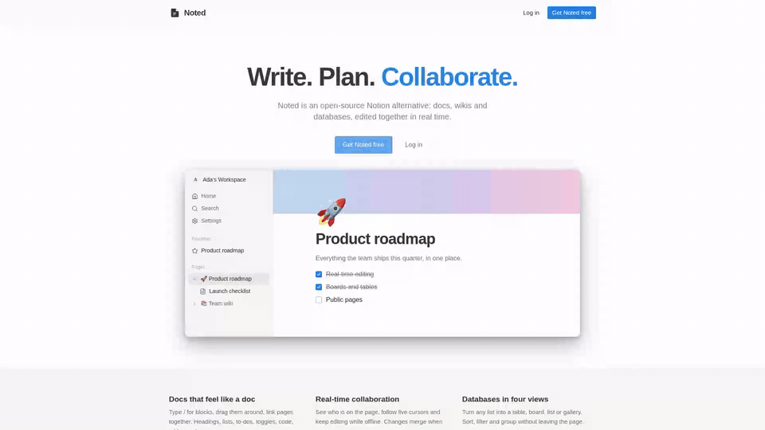
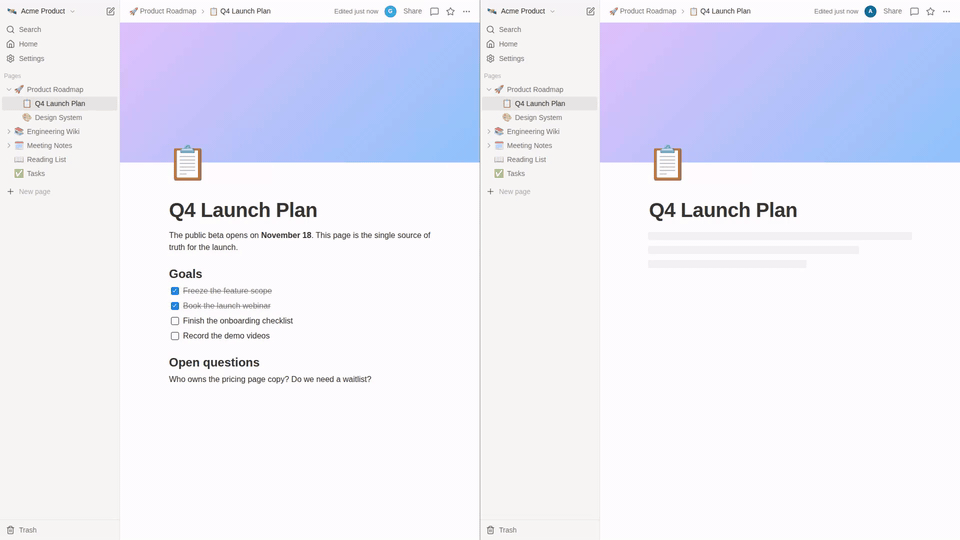
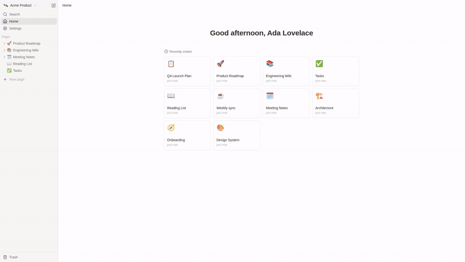
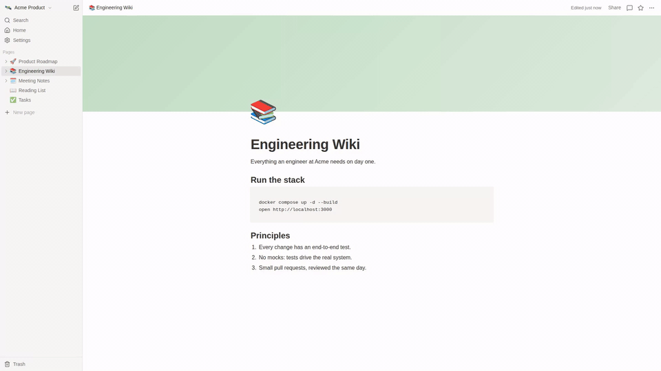

# Noted

Noted is an open-source Notion alternative. Write in a block editor with your team in real time, organize pages in a tree, track work in databases, and publish any page to the web. It runs on your own machine with one `docker compose` command.

Noted is built on [agusmdev/fullstack-ai-template](https://github.com/agusmdev/fullstack-ai-template): a FastAPI backend, a React 19 frontend (TanStack Start) and PostgreSQL 18.1.

## Demo

Click a preview to play the full video (1920x1080).

| | |
|---|---|
| [](docs/media/tour.mp4) | **Tour.** Sign in, move pages in the sidebar, write with the slash menu and the formatting toolbar, find a page with `Ctrl+K`, and switch to dark mode. |
| [](docs/media/collaboration.mp4) | **Collaboration.** Two people type in the same page and see each other's cursors, names, and new pages as they happen. |
| [](docs/media/databases.mp4) | **Databases.** Add a row and a property, filter and sort a table, drag a card on a board, and open a row as a page. |
| [](docs/media/share.mp4) | **Share and trash.** Publish a page, read it signed out, then delete pages and get them back with Undo and the Trash. |

`make demo-videos` records these videos again (see [Record the demo videos](#record-the-demo-videos)).

## Features

The full product contract is [docs/SPEC.md](docs/SPEC.md). In short:

1. **Accounts.** Sign up, log in and log out with an email and a password, or with Google.
2. **Workspaces.** Each person can have many workspaces. Switch between them from the sidebar, and rename them or give them an emoji.
3. **Members and roles.** Invite people by email as an owner, an editor or a viewer. Viewers can read but not change anything.
4. **Page tree.** Nest pages inside pages. Give each one an emoji and a cover. Reorder and move pages with drag and drop, or duplicate them with everything inside.
5. **Block editor.** Type `/` for headings, lists, to-dos, toggles, quotes, callouts, code, tables, images and links to other pages. Markdown shortcuts and a formatting toolbar also work.
6. **Real-time collaboration.** Everyone on a page sees the same text as it changes, with each person's cursor, name and avatar. Edits made offline merge when you reconnect.
7. **Live sidebar.** New, renamed, moved and deleted pages show up for every member at once.
8. **Trash.** A deleted page goes to the Trash with all its children. Undo from the toast, restore from the Trash, or delete forever.
9. **Favorites.** Star a page to pin it to the top of your sidebar.
10. **Search.** `Ctrl+K` (or `Cmd+K`) finds pages by title and by text, and shows recent pages before you type.
11. **Home.** A greeting and your recently visited pages.
12. **Page options.** Full width, small text, three fonts, lock, copy link, duplicate, move, and Markdown import and export.
13. **Share and publish.** Invite members from the page, or publish the page to a public link that anyone can read without an account.
14. **Comments.** Discuss a page: reply, edit, resolve and reopen. Comments update live.
15. **Databases.** Tables, boards, lists and galleries of rows, where each row is also a page. Eleven property types, plus sort, filter and hidden properties per view.
16. **Appearance.** Light, dark or system theme (`Ctrl+Shift+L`). The sidebar collapses (`Ctrl+\`) and resizes.
17. **Settings.** Your name, the theme, the workspace and its members, in one dialog.
18. **Landing page.** A short public page at `/` for people who are not signed in.

## Quick start

```bash
git clone https://github.com/croto-bot/notion-clone.git noted && cd noted
docker compose up -d --build
```

Open http://localhost:3000 and create an account. The API is on http://localhost:9095 (docs at `/docs`). To develop with hot reload, or to change the ports, read the sections below.

| Part | Stack | Docs |
|---|---|---|
| `backend/` | Python 3.12, FastAPI, SQLAlchemy 2 (async), Alembic, Pydantic 2, uv | [backend/AGENTS.md](backend/AGENTS.md) |
| `frontend/` | React 19, TanStack Start/Router/Query, Tailwind v4, shadcn/ui, BlockNote, Yjs, bun | [frontend/AGENTS.md](frontend/AGENTS.md) |
| `db` | PostgreSQL 18.1 (`postgres:18.1-alpine`) | `docker-compose.yml` |

## Testing

Every test drives the real system: there are no unit tests and no mocks. The backend suite sends HTTP and WebSocket requests to a live server on a real Postgres. The browser suite runs Playwright against the real frontend, backend and database, including two people editing one page. `make test` runs both suites, and [Tests](#tests) has the details. The coverage is measured, not claimed: the backend suite runs 95.32% of the backend's lines and the browser suite runs 98.43% of `frontend/src/` ([Coverage](#coverage)).

**Working with an AI agent?** It starts at [AGENTS.md](AGENTS.md). Code standards for agents and people: `.claude/skills/project-standards/SKILL.md`.

## 1. Prerequisites

- Docker with Compose v2
- [uv](https://docs.astral.sh/uv/) — backend outside Docker, backend tests, git hooks
- [bun](https://bun.sh/) — frontend outside Docker, frontend tests

## 2. Start everything with Docker

```bash
cp .env.example .env          # optional; every value has a default
docker compose up -d --build  # `make start` = `docker compose up -d` (no rebuild)
```

- Frontend: http://localhost:3000
- Backend API: http://localhost:9095 (no `/api` prefix; `GET /` is 404, check `/health`)
- API docs: http://localhost:9095/docs

The backend container runs the migrations (`alembic upgrade head`) before it starts. Logs: `make logs`. Stop: `make down`. Reset the database: `make db-reset`, then `docker compose up -d` (the reset leaves only `db` running).

## 3. Develop with hot reload (optional)

Run Postgres in Docker and the apps on your machine:

```bash
docker compose up -d db

# terminal 1
cd backend
cp .env.example .env          # DB_URL must match POSTGRES_* in the root .env
uv sync && uv run alembic upgrade head
make run                      # http://localhost:9095

# terminal 2
cd frontend
bun install && bun run dev    # http://localhost:3000
```

`make setup` copies both `.env` files and installs the backend and frontend dependencies in one step.

## 4. Git hooks

After `git init` (and `uv sync` in `backend/`, `bun install` in `frontend/`):

```bash
make pre-commit-install       # ruff, frontend eslint + prettier, demo-script prettier, no-mock guards
make pre-commit-run           # run them on every tracked file
```

The hooks are in `.pre-commit-config.yaml`. They are fast early warnings; the real checks are `make check` and `make test`.

## Environment

There are two sets of settings:

| File | Read by | Used for |
|---|---|---|
| `.env` (from `.env.example`) | Docker Compose | Ports, Postgres credentials, every backend setting for the container, the frontend build URL |
| `backend/.env` (from `backend/.env.example`) | the backend when you run it **outside** Docker (`make run`) | Same backend settings; `DB_URL` points at `localhost` |
| `frontend/.env` (from `frontend/.env.example`, optional) | `bun run dev` / `bun run build` outside Docker | `VITE_API_BASE_URL` |

Docker Compose does **not** read `backend/.env`. The backend container gets its settings only from `docker-compose.yml`, which takes them from the root `.env` (with defaults). All `.env` files are git-ignored; the `.env.example` files are committed.

### Root `.env` variables

| Variable | Default | Notes |
|---|---|---|
| `BACKEND_PORT`, `FRONTEND_PORT`, `DB_PORT` | `9095`, `3000`, `5432` | Host ports. Check what is free: `make check-ports` |
| `POSTGRES_USER`, `POSTGRES_PASSWORD`, `POSTGRES_DB` | the project name (`app` in the raw template; `ai-fsr init` sets them) | Used by `db`, and to build the backend `DB_URL` (host `db`) |
| `DB_URL` | built from `POSTGRES_*` | Not in `.env.example`. Set it only for an external Postgres, or when the password has `@ : / # %` (URL-encode them). Accepted schemes: `postgresql://`, `postgres://`, `postgresql+asyncpg://`, `postgresql+psycopg://` (the app and Alembic accept the same forms) |
| `DB_POOL_SIZE`, `DB_POOL_PRE_PING` | `100`, `false` | SQLAlchemy pool |
| `APP_NAME`, `ENVIRONMENT`, `DEBUG_MODE` | `backend`, `local`, `false` | Sentry is off when `ENVIRONMENT=local` |
| `LOG_LEVEL`, `LOG_FORMAT` | `INFO`, `console` | `json` = one wide event per request, for log shipping |
| `LOG_UVICORN_ERROR_LEVEL` | `WARNING` | Level of uvicorn's non-access logger (startup, shutdown, WebSocket accepts). `INFO` also shows those lines (the e2e stack sets it); the sanitizer redacts them either way |
| `FRONTEND_URL` | `http://localhost:3000` | CORS origin and OAuth redirect target. Keep in sync with `FRONTEND_PORT` |
| `SENTRY_DSN`, `SENTRY_TRACES_SAMPLE_RATE`, `SENTRY_PROFILES_SAMPLE_RATE` | empty, `0.0`, `0.0` | Empty DSN = off |
| `GOOGLE_CLIENT_ID`, `GOOGLE_CLIENT_SECRET` | empty | Empty = Google OAuth not set up |
| `GOOGLE_REDIRECT_URI` | `http://localhost:${BACKEND_PORT}/auth/oauth/google/callback` | Must match the Google console |
| `VERSION`, `COMMIT_HASH`, `INSTANCE_ID` | empty | Optional log context |
| `VITE_API_BASE_URL` | `http://localhost:9095` | Baked into the frontend image at build time |

### Change a port

Set the new port in `.env`. For the backend port, also change `VITE_API_BASE_URL` (and `GOOGLE_REDIRECT_URI` if you set it); for the frontend port, also change `FRONTEND_URL`. Then rebuild: `docker compose up -d --build`.

### Change the database credentials

Change `POSTGRES_*` in `.env` and the matching `DB_URL` in `backend/.env`. An existing database volume keeps the old credentials: reset it with `make db-reset` (this deletes the data), then run `docker compose up -d` (the reset starts only `db`).

## Tests

All tests are end to end against the real stack. There are no unit tests and no mocks.

```bash
make test             # both suites
make test-backend     # API suite: Postgres (testcontainers) + migrations + live server (needs Docker)
make test-e2e         # browser suite: Postgres + backend + Vite + Playwright (needs Docker, uv, bun, Chromium)
make check            # every static check: ruff, ESLint, prettier, tsc, build, demo scripts
make ci               # check + test
make test-backend-cov # backend suite + line and branch coverage of backend/app/ (backend/htmlcov/)
make test-e2e-cov     # browser suite + JS coverage of frontend/src/ (frontend/coverage/)
```

First Playwright run: `cd frontend && bunx playwright install --with-deps chromium`. The suites use their own ports (55432, 59095, 53000) and never touch the dev stack. The e2e frontend turns off the TanStack devtools event bus (fixed port 42069), so `bun run dev` can stay up.

Where tests go and how to write them: [AGENTS.md](AGENTS.md#testing-end-to-end-only) and `.claude/skills/project-standards/references/e2e-testing.md`.

### Coverage

Measured on 2026-10-17:

| Suite | Command | Tests | Lines | Branches |
|---|---|---|---|---|
| Backend (`backend/app/`, the live server process included) | `make test-backend-cov` | 304 | 95.32% (3405 of 3572) | 80.91% (500 of 618) |
| Browser (`frontend/src/`) | `make test-e2e-cov` | 151 | 98.43% (3529 of 3585) | 85.95% (1854 of 2157) |

The backend report is `backend/htmlcov/index.html`. The browser report is `frontend/coverage/index.html` (also `lcov.info` and `coverage-summary.json`): Playwright's `page.coverage` records the V8 coverage of every page, and `monocart-coverage-reports` maps it to `src/` through the Vite dev server's source maps. A `src/` file that no test loads counts as 0%. A few paths depend on timing (a socket that reconnects, a request that loses a race), so the browser numbers can move by a few lines from run to run. `E2E_COVERAGE=1` makes the browser slower, so in that mode each test and each `expect` gets three times as long.

The lines no test runs, and why:

| Where | Why no test runs it |
|---|---|
| `backend/app/repositories/`, `services/base_crud_service.py`, `core/filters.py`, `database/db/` | The shared base classes that the standards tell each new entity to use. No feature calls these generic methods yet. |
| `backend/app/user/auth/service.py`, `user/service.py` | The success path of Google sign-in. It needs Google; the suite never fakes it (`KNOWN_GAPS` in `backend/tests/e2e/guards.py`). |
| `backend/app/main.py` | Sentry setup: it runs only with `SENTRY_DSN`. |
| `backend/app/modules/pages/ordering.py` | Guards for order keys that the API never makes (an exhausted key, a reversed pair). |
| `backend/app/modules/events/bus.py` | A subscriber whose queue is full. A real socket reader empties it first. |
| `frontend/src/lib/clipboard.ts`, `lib/client-id.ts` | Fallbacks for an insecure origin (plain http on a host that is not `localhost`/`127.0.0.1`). The suite runs on `127.0.0.1`, a secure origin. |
| `frontend/src/components/ErrorBoundary.tsx` | Shows only when a render throws. No user action makes the app throw. |
| `frontend/src/contexts/WorkspaceContext.tsx` | The screens for a failed workspace load or create. They need a backend 5xx, and the suite does not inject faults. |
| `frontend/src/lib/error-handler.ts`, `lib/auth.ts` | A thrown value that is not an `Error`; a 401 that arrives after another tab already replaced the session (a race the suite cannot time without network interception). |

## Record the demo videos

`make demo-videos` records the four videos in `docs/media/` again. It needs Docker, uv, ffmpeg, Node 22.18 or later (Node runs the TypeScript recorder directly), and the frontend dependencies with Chromium (`cd frontend && bun install && bunx playwright install chromium`).

The target does three things:

1. `scripts/demo/stack.sh up` starts a separate stack: Postgres in a container named `noted-demo-db` (port 57732, data in memory), the backend (port 57195), and a production build of the frontend (port 57400). Set `DEMO_DB_PORT`, `DEMO_BACKEND_PORT` or `DEMO_FRONTEND_PORT` to use other ports, and `DEMO_DB_IMAGE` to use another Postgres image (default: the `db` image in `docker-compose.yml`). If a step fails or you press Ctrl-C, it stops what it already started. Each wait stops after 2 minutes.
2. `node scripts/demo/record.ts` seeds a demo workspace through the API before each video, films Chromium at 1920x1080, and writes `docs/media/<video>.mp4` (H.264) and `docs/media/<video>.gif` (the first 8 seconds). If an expected element does not appear, it stops with an error and saves a screenshot in `scripts/demo/out/`.
3. `scripts/demo/stack.sh down` stops only what step 1 started. It also runs when step 1 or step 2 fails. It stops a server only if its PID still runs the command that step 1 started.

To record one video, run `make demo-videos SCENES=tour`. The names are `tour`, `collaboration`, `databases` and `share`. `scripts/demo/check.sh` prints the format of each video and saves three frames of each to look at. `make demo-check` checks the recorder scripts (prettier and `tsc --noEmit`, with the frontend's pinned versions). `make check` runs it.

## Make targets

Run `make help` for the full list. The most used:

| Target | What it does |
|---|---|
| `make start` / `make down` | Start the stack in the background / stop it |
| `make logs`, `make logs-backend` | Follow logs |
| `make rebuild` | Rebuild images and start |
| `make migrate`, `make migrate-create message="..."`, `make migrate-rollback` | Alembic |
| `make db-shell`, `make db-reset` | psql in the `db` container / wipe and re-migrate (only `db` runs afterwards; then `docker compose up -d`) |
| `make lint`, `make lint-fix`, `make format`, `make typecheck` | Code quality (both apps) |
| `make backend-typecheck` | ty on the backend (advisory, not in CI) |
| `make clean` | Remove this project's containers, networks and volumes |

## Troubleshooting

| Problem | Fix |
|---|---|
| Port already in use | `make check-ports`, then change the port in `.env` (see above) |
| Backend cannot reach the database | `docker compose ps`, `make logs-db`; after a credential change run `make db-reset`, then `docker compose up -d` |
| Frontend calls the wrong backend URL | `VITE_API_BASE_URL` is baked in at build time: `docker compose up -d --build frontend` |
| `make test-e2e` says a port is busy | Another e2e run uses it. Wait, or set `E2E_DB_PORT`, `E2E_BACKEND_PORT`, `E2E_FRONTEND_PORT` |
| `bun run dev` fails with `EADDRINUSE ... 42069` | Another `bun run dev` holds the TanStack devtools port. Stop it (e2e runs do not use 42069) |
